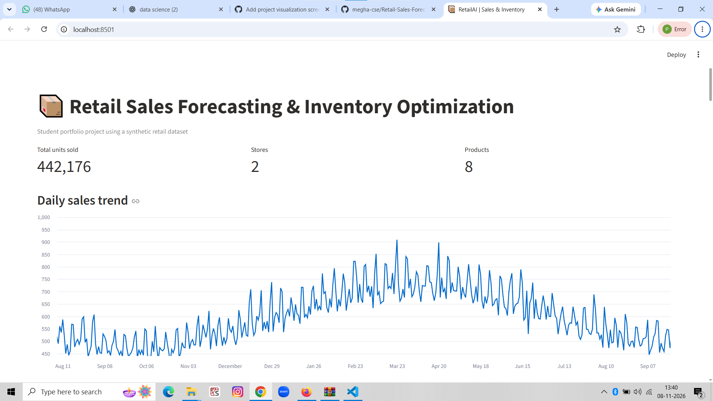
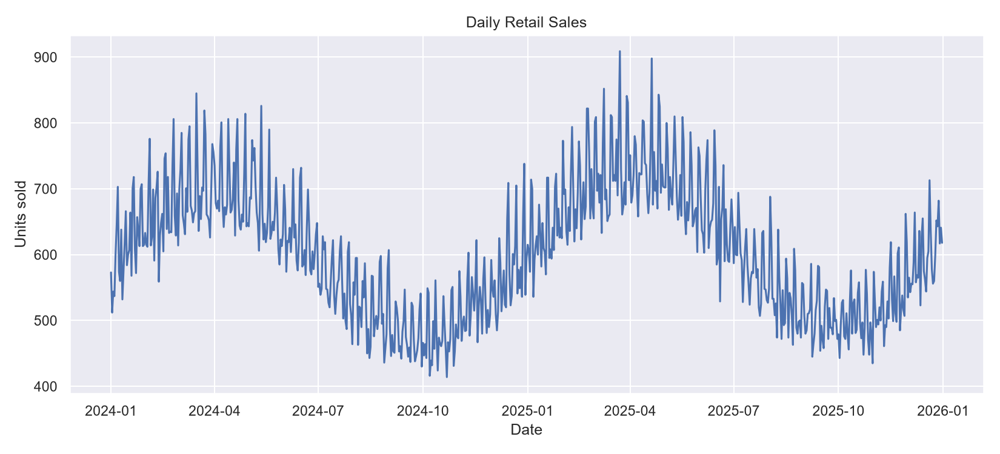
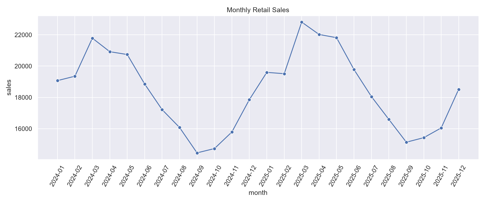
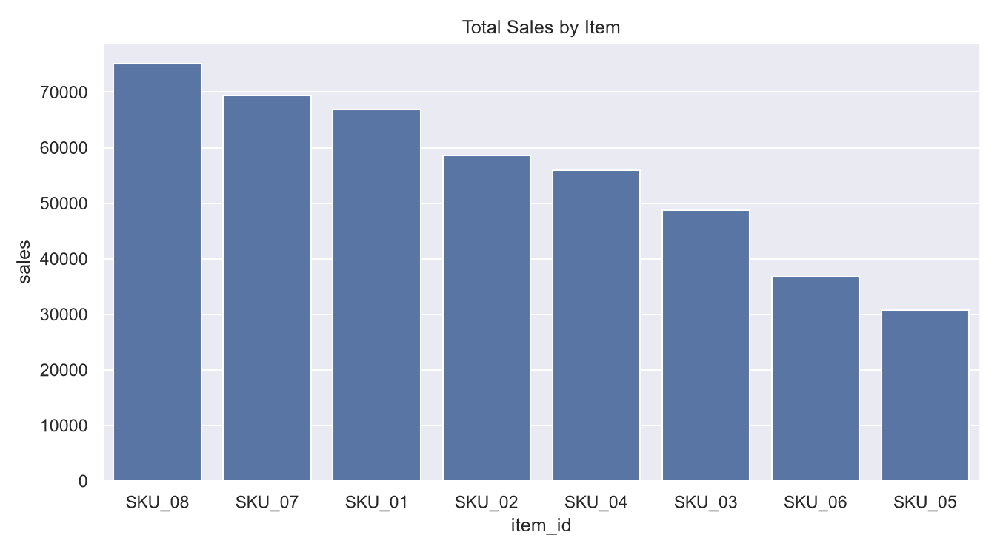
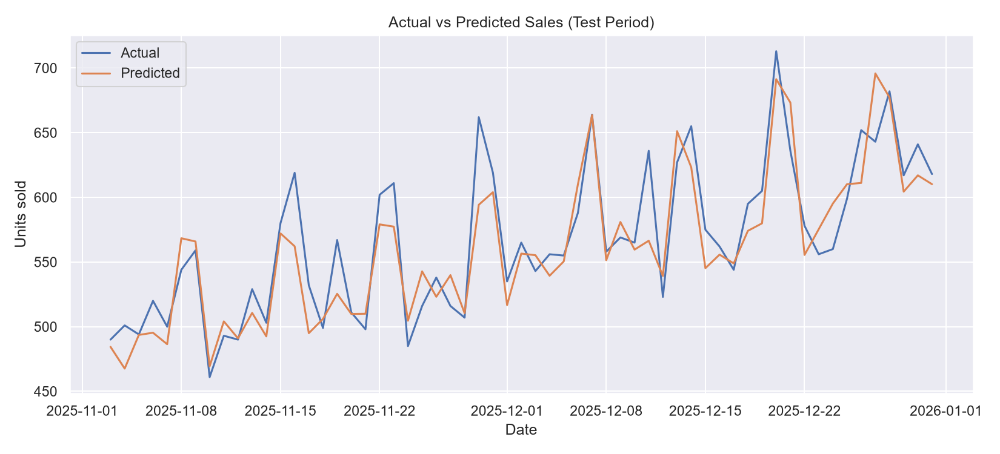

# Retail Sales Forecasting & Inventory Optimization System

A beginner-friendly student portfolio project that creates synthetic retail sales data, explores trends, trains a Random Forest forecasting model, and produces basic inventory reorder recommendations.

# 📦 Retail Sales Forecasting & Inventory Optimization System

🚀 **Live Demo:** [Click Here to View Dashboard](https://retail-sales-forecasting-megha.streamlit.app/)

💻 **GitHub Repository:** [View Source Code](https://github.com/megha-cse/Retail-Sales-Forecasting-Inventory-Optimization)

## Features
- Synthetic daily sales data for two stores and eight products
- Data cleaning and exploratory charts
- Random Forest regression with a chronological holdout test period
- MAE, RMSE, and R² evaluation
- Basic safety stock, reorder point, and EOQ calculations
- Streamlit dashboard and CSV export

## Requirements
- Python 3.12 recommended
- Windows, macOS, or Linux

## Setup (Windows PowerShell)
```powershell
py -3.12 -m venv .venv
Set-ExecutionPolicy -Scope Process -ExecutionPolicy Bypass
.\.venv\Scripts\Activate.ps1
python -m pip install --upgrade pip
pip install -r requirements.txt
```

## Run the full pipeline
```powershell
python run_pipeline.py
```

## Launch the dashboard
```powershell
streamlit run app.py
```

## Output files
- `data/retail_sales.csv`
- `data/cleaned_sales.csv`
- `models/retail_forecast_model.pkl`
- `outputs/` charts, metrics, predictions, and inventory recommendations

## Important project notes
This project uses simulated data, not live company data. The inventory module demonstrates transparent baseline calculations. Its simulated current stock is set to ten days of average demand; replace this assumption with actual on-hand stock and supplier lead-time data for a real deployment.

The model is a learning baseline, not a production replenishment system. More advanced future work could include rolling-origin backtesting, Croston/SBA for intermittent demand, promotion and holiday features, service-level tuning, and model monitoring.
## 📸 Project Screenshots

### 1. Main Dashboard


### 2. Sales Trend Analysis


### 3. Monthly Sales Analysis


### 4. Item-wise Sales Analysis


### 5. Sales Forecast Comparison
